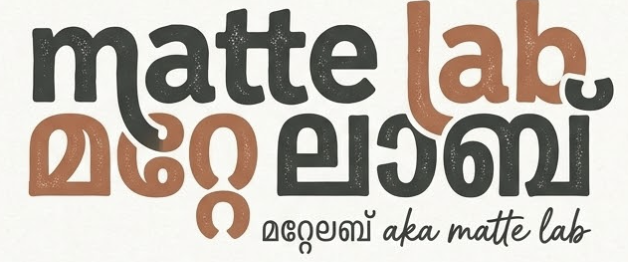

<div align="center">

  

  # MatteLab — Makerspace & Innovation Hub
  ### College of Engineering Trikaripur (CETKR)

  <p align="center">
    <strong>A high-craft digital operating system for university makerspaces, hardware labs, and student innovators.</strong><br />
    Supported by <strong>TinkerHub CETKR</strong> & <strong>IEDC CETKR</strong>.
  </p>

  <p align="center">
    <a href="https://react.dev/"></a>
    <a href="https://vite.dev/"></a>
    <a href="https://tailwindcss.com/"></a>
    <a href="https://firebase.google.com/"></a>
    <a href="https://fullcalendar.io/"></a>
    
  </p>

  <p align="center">
    <a href="#-features">Features</a> •
    <a href="#-tech-stack">Tech Stack</a> •
    <a href="#-architecture--project-structure">Architecture</a> •
    <a href="#-key-services--functions">Key Functions</a> •
    <a href="#-database-schema--security">Database & Security</a> •
    <a href="#-getting-started--development">Getting Started</a> •
    <a href="#-contributing">Contributing</a>
  </p>

  <hr />
</div>

> *"Dream It · Solder It · Build It"* — MatteLab provides students, makers, and organizers at the College of Engineering Trikaripur with a seamless platform to schedule lab machinery, book 3D printers, register for hackathons and technical workshops, propose new student-led initiatives, and manage campus lab resources.

---

## Features

### 1. Brutalist-Editorial Campus Design
- **Signature Visual Identity**: Tailored color palette combining warm cream canvas (`#FCF0DA`), olive sage (`#AEAC78`), warm honey gold (`#F2C46A`), and deep espresso charcoal (`#4C4541`).
- **Kinetic Curtain Entrance**: 10 staggered vertical slices that unmask on page load with custom easing physics.
- **Morphing Island Header**: Seamlessly morphs from a full-width edge-to-edge bar at the top of the viewport into a floating docked capsule pill upon scrolling (`scrollY > 15`).
- **Dark & Light Mode**: Theme toggle with automatic system preference detection and persistent `localStorage` synchronization.
- **Adaptive Mobile Dock**: Sticky bottom navigation tailored for mobile viewports with notification badges.

### 2. Authentication & Role-Based Access Control (RBAC)
- **Google OAuth 2.0**: Zero-friction login with college Google credentials.
- **Automatic User Provisioning**: Auto-creates user profiles in Firestore on first sign-in.
- **Multi-Tier Roles**:
  - `student`: Browse catalog, propose workshops, register for events, and reserve equipment slots.
  - `organizer`: Propose workshops with expedited review flags and oversee activities.
  - `admin`: Full moderation privileges — approve/reject event proposals, create instant events, add/edit/deactivate equipment, and delete reservations.

### 3. Workshop & Event Management Hub
- **Community Workshop Proposals**: Students and clubs can propose events with equipment requests, capacity caps, and venue selections.
- **Strict Guidelines Agreement**: Built-in enforcement of safety, workbench etiquette, and academic purpose guidelines before submission.
- **Schema Validation**: Powered by **Zod** and **React Hook Form** to ensure valid event timings, deadlines, and seat capacity (1–500).
- **Admin Moderation Queue**: Organizers and admins can review pending submissions, approve to publish to the catalog, or reject with explanatory feedback.
- **One-Click Event Registration**: Real-time spot reservations with remaining seat counters and the ability to release spots.

### 4. Machinery & Space Reservation (FullCalendar)
- **Interactive Calendar Schedule**: Powered by `@fullcalendar/react` with DayGrid and TimeGrid views showing live bookings.
- **Concurrency-Safe Firestore Transactions**: Uses atomic transactions to prevent double-booking collisions (`existing.start < new.end && existing.end > new.start`).
- **Resource Management**: Filter and manage machinery (3D printers, laser cutters, CNCs, soldering stations) and spaces (testing bays, workbench stations).
- **Time Constraints**: Enforces lab operating hours (08:30 AM – 08:00 PM) and reservation limits (15 minutes to 4 hours).

### 5. Interactive Makerspace Mascot
- **Contextual Helper & Companion**: Floating interactive canvas mascot widget.
- **Live Lab Occupancy Sensing**: Reactively listens to Firestore to compute lab status (`free`, `busy`, or `closed` outside operating hours).
- **Dynamic Dialogues**: Sparks maker creativity with thought-provoking hardware prompts, safety reminders, and instant schedule shortcuts.
- **Accessibility Friendly**: Supports mute state persistence and respects `prefers-reduced-motion`.

### 6. Maker Identity & Registrations Dashboard
- **My Registrations**: Dedicated dashboard tracking all upcoming workshop tickets and active machinery reservations.
- **Self-Service Cancellation**: Clean cancellation workflow that frees resources for fellow students.
- **Maker Profile**: Displays verified account details, role badges, and participation history.

---

## 💻 Tech Stack

### Frontend & Core
| Technology | Version | Purpose |
| :--- | :--- | :--- |
| **[React](https://react.dev/)** | `^19.0.0` | Declarative UI framework with modern hooks and state management |
| **[Vite](https://vite.dev/)** | `^6.0.7` | Lightning-fast development server and optimized build bundler |
| **[Tailwind CSS](https://tailwindcss.com/)** | `^3.4.17` | Utility-first CSS styling and custom design token integration |
| **[Lucide React](https://lucide.dev/)** | `^0.475.0` | Comprehensive and consistent icon library |

### Scheduling & Data Validation
| Technology | Version | Purpose |
| :--- | :--- | :--- |
| **[@fullcalendar/react](https://fullcalendar.io/)** | `^6.1.15` | Interactive calendar views (`timegrid`, `daygrid`, `interaction`) |
| **[date-fns](https://date-fns.org/)** | `^4.4.0` | Modern, modular JavaScript date utility library |
| **[React Hook Form](https://react-hook-form.com/)** | `^7.89.0` | Performant form management and minimal re-render cycles |
| **[Zod](https://zod.dev/)** | `^4.6.5` | TypeScript-first schema declaration and runtime validation |

### Backend & Cloud Services
| Technology | Version | Purpose |
| :--- | :--- | :--- |
| **[Firebase JS SDK](https://firebase.google.com/)** | `^11.0.2` | Client SDK for Cloud Firestore and Firebase Authentication |
| **Firebase Auth** | v11 | Secure Google Sign-In with popup providers |
| **Cloud Firestore** | v11 | Real-time NoSQL cloud database with document transactions and security rules |

### Typography
- **Headings & Badges**: `Bebas Neue` & `Outfit`
- **Editorial Subtitles**: `Newsreader` (High-contrast Serif)
- **UI & Body**: `Plus Jakarta Sans` & `Inter`

---

##  Architecture & Project Structure

```text
mattelab/
├── public/                       # Static public assets (logos, icons, manifest)
│   ├── favicon.svg
│   ├── logo.png
│   └── mattelab-logo.png
├── src/
│   ├── assets/                   # Vector assets, mascot graphics, brand imagery
│   │   ├── mascot.png
│   │   └── mattelab.png
│   ├── components/               # React UI components & view controllers
│   │   ├── mascot/               # Interactive Mascot widget
│   │   │   ├── Mascot.jsx        # Mascot main component & physics
│   │   │   ├── Mascot.css        # Speech bubbles and animations
│   │   │   ├── lines.js          # Dialogue prompts and voice lines
│   │   │   └── useLabStatus.js   # Real-time lab free/busy occupancy hook
│   │   ├── ui/                   # Reusable atomic UI primitives
│   │   │   ├── badge.jsx         # Status badge tokens
│   │   │   ├── button.jsx        # Styled brutalist button variants
│   │   │   ├── card.jsx          # Card containers
│   │   │   ├── input.jsx         # Form input controls
│   │   │   ├── table.jsx         # Data tables
│   │   │   └── textarea.jsx      # Textarea controls
│   │   ├── AdminResourcesView.jsx# Resource inventory & calendar toggle
│   │   ├── BookingDetailModal.jsx# Booking info & cancellation view
│   │   ├── BookingFormModal.jsx  # Equipment reservation form with Zod
│   │   ├── ConfirmModal.jsx      # Confirmation modal for destructive actions
│   │   ├── CreateEventModal.jsx  # Event proposal form with guidelines
│   │   ├── EventsView.jsx        # Events catalog, filters & admin queue
│   │   ├── Footer.jsx            # Campus makerspace editorial footer
│   │   ├── Header.jsx            # Morphing island header
│   │   ├── LoginView.jsx         # Landing page & Google OAuth sign-in
│   │   ├── MatteLabHero.jsx      # Brutalist hero banner & curtain unmask
│   │   ├── MobileNav.jsx         # Bottom docked mobile navigation bar
│   │   ├── MyRegistrationsView.jsx# User workshops & machine reservations
│   │   ├── Overview.jsx          # Dashboard home & quick stats
│   │   ├── ProfileView.jsx       # User identity card & credentials
│   │   ├── ResourceCalendarView.jsx# FullCalendar equipment scheduler
│   │   ├── ResourceModal.jsx     # Add/Edit machine or space modal
│   │   └── TopNav.jsx            # Top navigation bar connector
│   ├── context/                  # React Context state providers
│   │   ├── AuthContext.jsx       # Google Auth, user roles & session
│   │   ├── ThemeContext.jsx      # Light/Dark mode state & DOM toggle
│   │   └── ToastContext.jsx      # Global toast notification alerts
│   ├── services/                 # Firebase Firestore backend integration
│   │   ├── bookings.js           # Reservation transactions & collision detection
│   │   ├── events.js             # Event proposals, approvals & queries
│   │   └── resources.js          # Machine & space CRUD operations
│   ├── App.css                   # Layout utilities
│   ├── App.jsx                   # Main application router and tab orchestrator
│   ├── firebase.js               # Firebase client configuration
│   ├── index.css                 # Global CSS styles, themes, and font imports
│   └── main.jsx                  # React application entry point
├── firestore.rules               # Production Firestore database security rules
├── index.html                    # HTML entry point with Google Fonts
├── package.json                  # Dependencies, scripts, and package metadata
├── tailwind.config.js            # Design tokens, custom palette & typography
└── vite.config.js                # Vite build and port configuration (port: 8080)
```

---

## Key Services & Functions

### 1. `src/services/bookings.js`
Handles resource reservations using atomic transactions to guarantee that overlapping bookings are never created:
- `createBooking({ resourceId, userId, userName, userEmail, title, notes, start, end })`: Executes a Firestore transaction, checks for existing overlaps (`existing.start < new.end && existing.end > new.start`), updates `lastBookingAt` concurrency lock, and inserts the confirmed reservation.
- `subscribeToResourceBookings({ resourceId, startDate, endDate, onUpdate, onError })`: Sets up a real-time Firestore listener with a 1-day boundary buffer for the active calendar view range.
- `cancelBooking(bookingId, userId, isAdmin)`: Validates ownership or admin permissions and marks the booking status as `cancelled`.
- `subscribeToUserBookings(userId, onUpdate, onError)`: Real-time listener for all active bookings owned by the authenticated user.

### 2. `src/services/events.js`
Manages event proposals and approval workflows:
- `createEventProposal(formData, currentUser, isAdmin)`: Validates future start dates, deadlines, and guidelines agreement. Admins can publish immediately; standard members create proposals with `pending` status.
- `approveEvent(eventId, adminUser)`: Transitions proposal from `pending` to `published`, setting approval metadata.
- `rejectEvent(eventId, adminUser, reason)`: Declines proposal with a designated feedback reason.
- `fetchAllEvents(currentUser, isAdmin)`: Loads and segments events into `published`, `pending`, `myProposals`, and `registeredEventIds`.

### 3. `src/services/resources.js`
Manages machinery and lab facilities:
- `getResources()`: Fetches all registered equipment and spaces ordered by creation date.
- `addResource(resourceData, userId)`: Adds a new machine or space (`type: 'machine' | 'space'`).
- `updateResource(id, updateData)`: Modifies resource specifications or location.
- `toggleResourceStatus(id, currentStatus)`: Toggles active status (`'active' <-> 'inactive'`) for maintenance.
- `deleteResource(id)`: Removes resource from catalog.

### 4. `src/context/AuthContext.jsx`
Supplies application-wide authentication and role states:
- `currentUser`: Firebase Auth user profile object.
- `userProfile`: Synchronized Firestore user record containing role data (`student`, `organizer`, `admin`).
- `isAdmin` / `isOrganizer`: Boolean permission flags based on database role and approved email lists.
- `loginWithGoogle()`: Triggers Google popup sign-in.
- `logout()`: Terminates active session.

---

## 🗄️ Database Schema & Security

### Firestore Collections

#### `users/{userId}`
```typescript
{
  name: string;
  email: string;
  role: "student" | "organizer" | "admin";
  createdAt: Timestamp;
}
```

#### `resources/{resourceId}`
```typescript
{
  name: string;               // e.g. "Bambu Lab X1-Carbon 3D Printer"
  description: string;
  type: "machine" | "space";
  location: string;          // e.g. "Makerspace Bay 1"
  status: "active" | "inactive";
  lastBookingAt?: Timestamp;
  createdBy: string;
  createdAt: Timestamp;
  updatedAt: Timestamp;
}
```

#### `bookings/{bookingId}`
```typescript
{
  resourceId: string;
  userId: string;
  userName: string;
  userEmail: string;
  title: string;              // Booking purpose / project name
  notes: string;
  start: Timestamp;
  end: Timestamp;
  status: "confirmed" | "cancelled";
  createdAt: Timestamp;
  updatedAt: Timestamp;
  cancelledAt?: Timestamp;
  cancelledBy?: string;
}
```

#### `events/{eventId}`
```typescript
{
  title: string;
  description: string;
  category: "Workshop" | "Hackathon" | "Talk" | "Hands-on Lab";
  venue: string;
  equipmentNeeded?: string;
  startAt: Timestamp;
  registrationDeadline: Timestamp;
  capacity: number;           // 1 to 500
  registrationUrl?: string;   // Optional external form/website
  status: "pending" | "published" | "rejected";
  guidelinesAccepted: boolean;
  createdBy: string;
  creatorName: string;
  creatorEmail: string;
  createdAt: Timestamp;
  approvedBy?: string;
  approvedAt?: Timestamp;
  rejectedBy?: string;
  rejectionReason?: string;
}
```

#### `events/{eventId}/registrations/{userId}`
```typescript
{
  userId: string;
  name: string;
  email: string;
  registeredAt: Timestamp;
  checkedIn: boolean;
}
```

### Security Rules Highlights (`firestore.rules`)
- **Authentication**: All read and write operations require an authenticated session (`request.auth != null`).
- **Resource Protection**: Any authenticated user can read resources; only verified admins/organizers can create, edit, or delete machinery. Authenticated users can update only `lastBookingAt` during concurrency checks.
- **Booking Isolation**: Users can create bookings only for themselves with valid chronological ranges (`start < end`). Cancellation is restricted to the booking owner or administrators.
- **Moderation Workflow**: Regular users can only submit proposals with `status == 'pending'`. Only administrators and organizers can set `status == 'published'`.

---

## 🚀 Getting Started & Development

### Prerequisites
- **Node.js**: v18.0.0 or higher
- **npm**: v9.0.0 or higher (or `pnpm` / `yarn`)
- **Firebase Project**: A Firebase project with **Authentication (Google provider)** and **Cloud Firestore** enabled.

### 1. Clone Repository
```bash
git clone https://github.com/sravanvishnu/mattelab.git
cd mattelab
```

### 2. Install Dependencies
```bash
npm install
```

### 3. Firebase Configuration
The Firebase client configuration resides in `src/firebase.js`:
```javascript
const firebaseConfig = {
  apiKey: "YOUR_API_KEY",
  authDomain: "YOUR_PROJECT_ID.firebaseapp.com",
  projectId: "YOUR_PROJECT_ID",
  storageBucket: "YOUR_PROJECT_ID.firebasestorage.app",
  messagingSenderId: "YOUR_SENDER_ID",
  appId: "YOUR_APP_ID",
  measurementId: "YOUR_MEASUREMENT_ID"
};
```
*(Optionally refactor into environment variables using `import.meta.env.VITE_FIREBASE_*`).*

### 4. Deploy Firestore Rules
To deploy security rules using the Firebase CLI:
```bash
npm install -g firebase-tools
firebase login
firebase use YOUR_PROJECT_ID
firebase deploy --only firestore:rules
```

### 5. Start Local Development Server
```bash
npm run dev
```
The application will launch at **`http://localhost:8080`**.

### 6. Production Build
```bash
# Build the production bundle
npm run build

# Preview the production build locally
npm run preview
```

---

## 🤝 Contributing

We welcome contributions from students, engineers, and community members!

1. **Fork the Repository** on GitHub.
2. **Create a Feature Branch**:
   ```bash
   git checkout -b feature/amazing-feature
   ```
3. **Commit Your Changes**:
   ```bash
   git commit -m "feat: add equipment maintenance logger"
   ```
4. **Push to Your Branch**:
   ```bash
   git push origin feature/amazing-feature
   ```
5. **Open a Pull Request** with a detailed explanation of your changes.

---

## 📜 Code of Conduct & Guidelines

All events and equipment reservations in MatteLab must adhere to:
1. **Safety First**: Wear required PPE when operating 3D printers, laser cutters, CNCs, and soldering equipment.
2. **Clean Workbench Policy**: Return all tools and clean workstations upon session completion.
3. **Inclusive Learning**: Workshops must remain open and accessible to all student makers regardless of branch or year.

---

## 🏛️ Credits & Acknowledgements

- **Institution**: [College of Engineering Trikaripur (CETKR)](https://cetkr.ac.in)
- **Communities**: [TinkerHub CETKR](https://tinkerhub.org) & IEDC CETKR

---

<div align="center">
  <sub>Built with ❤️ for the makers, builders, and tinkerers of College of Engineering Trikaripur.</sub>
</div>
